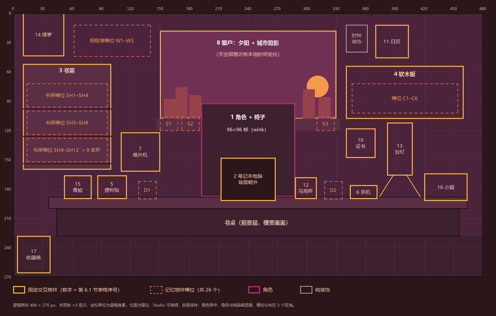

# 「像素小屋」互动个人主页：设计稿与需求文档

> 版本 v1.1 · 2026-11-18
> 交付对象：设计/开发 Studio
> 附件（和本文档放在同一个文件夹里）：
> - `附图1-风格参考.png`：书桌正面、台灯在右、桌上有青蛙玩偶
> - `附图2-风格参考.png`：台灯在左、窗外夕阳、桌上有小猫
> - `room-layout-wireframe.png`：房间布局线框图（第 5.2 节）
> - `tools/pixel_snap.py`：把 AI 生成图吸附成真像素素材的脚本（附录 D）
> - `tools/吸附前后对比.png`：脚本效果示例
>
> 附图 1、2 用作**角色与整体风格参考**
> 文中 `{{…}}` 为甲方待填内容，见第 17 节「待甲方提供」

---

## 0. 一句话说明

做一个 **2D 像素风的 Q 版小房间**，嵌入我现有的个人网站。房间里坐着我的 Q 版形象，桌上、墙上、书架上摆满物件。**点击任意物件 → 播放一段小动画 → 打开介绍我的某一面**（工作、项目、经历、爱好……）。

另外有一个核心功能：**我每上传一张照片，系统就把它变成房间里的一个像素小摆件**（例如旅行照变成雪花水晶球，演唱会照变成票根）。访客点开这个摆件，会看到原照片和照片背后的故事。房间会随着照片的增加慢慢被填满。

---

## 1. 项目目标与范围

### 1.1 目标
| # | 目标 | 衡量方式 |
|---|------|---------|
| G1 | 让访客在 30 秒内记住「这个人是谁、在做什么」 | 首屏 3 秒内能看出主角和可点击物件；关于我、工作两个入口最显眼 |
| G2 | 用探索代替阅读，提高停留时间 | 平均每位访客点开 ≥ 3 个物件（埋点统计） |
| G3 | 照片能持续变成房间里的物件 | 我上传一张照片后，10 分钟内能在后台审核并发布成新物件 |
| G4 | 招聘方能快速看到信息，不用"玩"也行 | 提供「快速浏览 / 简历模式」，一键看到全部文字信息 |
| G5 | 能无缝嵌入现有网站 | 用 iframe 或 Web Component 嵌入，与主站的 2D 动效风格一致 |

### 1.2 访客画像
- **招聘方 / HR / 合作方**：时间少，要快速拿到经历和联系方式，所以 G4 很重要
- **朋友 / 同学 / 网友**：愿意探索，会看照片、找彩蛋
- **我自己（站长）**：要能低成本地持续更新照片和内容，不用写代码

### 1.3 不做的事（本期）
- 不做多房间或可行走的角色移动（角色固定坐在书桌前）
- 不做访客留言、评论、登录
- 不做 3D 或等距（isometric）视角
- 不做访客上传，只有站长能上传

---

## 2. 体验流程

```
加载页（像素进度条「正在整理房间…」）
   ↓
房间入场动画：灯亮起 → 窗外夕阳淡入 → 角色抬头 wink
   ↓
首次访问引导：角色头顶出现对话气泡「嗨！点点房间里的东西看看吧～」
              同时 2 个推荐物件（笔记本电脑、书架）上方有闪烁的像素箭头
   ↓
自由探索：悬停物件会高亮并显示名称，角色的视线会跟着看过去
   ↓
点击物件：物件弹跳 → 镜头推近 → 像素转场 → 打开内容面板
   ↓
看完关闭：镜头拉回，物件归位；已看过的物件会有个小勾或者淡一点
   ↓
随时可以用：右上角 HUD（声音 / 中英 / 物件清单 / 快速浏览 / 联系我）
```

**关键原则**：任何内容最多 **2 次点击** 就能看到；任何面板都能用 Esc、点击遮罩或关闭按钮退出。

---

## 3. 美术规范（Art Bible）

### 3.1 风格关键词
`Lo-fi 像素风` · `黄昏书房` · `暖梅紫 + 夕阳橙` · `Q 版 2.5 头身` · `治愈 / 安静 / 一点点俏皮` · `16-bit 精致像素（不是 8-bit 粗块）`

> **重要说明**：
> 1. **所有美术都必须是图片素材（PNG），不能用代码（div / CSS / SVG 几何图形）去「画」房间、角色和物件。** 代码只负责把图片摆好、加热区和动效。用代码画出来的会是扁平的矢量卡通，不是像素画。
> 2. 两张参考图的像素网格不统一（有放大、模糊、像素大小不一致），不能直接切图使用。正式素材可以由像素画师绘制，也可以用 AI 生图后，再用 `tools/pixel_snap.py` 吸附到统一网格、锁定主调色板，最后人工修一遍（流程见附录 D）。

### 3.2 像素规格
| 项目 | 规范 |
|------|------|
| 逻辑分辨率（房间画布） | **480 × 270 px**（16:9） |
| 显示缩放 | 优先用整数倍：×2 = 960×540，×3 = 1440×810，×4 = 1920×1080。渲染统一用 `image-rendering: pixelated`（最近邻采样） |
| 网格 | 所有素材都在同一个 1px 逻辑网格上。**禁止混用不同像素大小（mixels）** |
| 移动 | 所有位移都对齐到整数逻辑像素，不允许亚像素移动 |
| 描边 | 1px 描边。外轮廓用 `ink-900`；内部描边用该区域颜色的深一档（sel-out 选择性描边） |
| 渐变 | 不用平滑渐变。天空和光锥用 2×2 / 4×4 Bayer 抖动（dither）过渡 |
| 抗锯齿 | 只允许手工 AA，不允许软件自动 AA |
| 单个精灵用色 | 每个物件 ≤ 12 色，全部从主调色板里取 |
| 旋转/缩放 | 精灵本身不做任意角度旋转；缩放只在转场里用，而且要用整数倍 |

### 3.3 主调色板（从参考图提取）

整体像是加了一层暖色滤镜：**没有纯蓝、没有纯绿**，绿色偏橄榄，阴影偏梅紫。

| Token | Hex | 名称 | 主要用途 |
|-------|-----|------|---------|
| `ink-900` | `#1C1215` | 墨 | 外轮廓、最深阴影 |
| `plum-900` | `#2C161A` | 夜梅 | 页面底色、面板底色 |
| `plum-800` | `#3D202E` | 深梅 | 墙面阴影、家具暗部 |
| `plum-700` | `#4B243B` | 墙梅 | 墙面主色 |
| `plum-600` | `#582F44` | 木梅 | 书架、书桌中间调 |
| `mauve-500` | `#702F53` | 暮紫 | 天空上沿、布料 |
| `magenta-500` | `#A62B66` | 霞红 | 晚霞、强调色 |
| `brick-500` | `#95424A` | 砖红 | 城市剪影、书脊 |
| `coral-400` | `#EA6949` | 珊瑚 | 夕阳、「新」标记 |
| `orange-400` | `#F5994A` | 落日橙 | 太阳、暖色高光 |
| `amber-300` | `#FDB644` | 灯光琥珀 | 台灯光、hover 描边、键盘焦点框 |
| `apricot-200` | `#FBCDA6` | 杏 | 深色底上的正文文字、亮部 |
| `cream-100` | `#F8F0E6` | 奶白 | 拍立得相纸、最亮的高光（眼镜反光） |
| `skin-300` | `#FCB989` | 肤 | 皮肤 |
| `skin-500` | `#D48A59` | 肤影 | 皮肤阴影 |
| `blush-400` | `#F8A078` | 腮红 | 脸颊腮红（没有这个颜色，吸附后腮红会消失） |
| `hair-500` | `#A45939` | 发亮 | 头发亮部（逆光边缘光） |
| `hair-700` | `#6B3A35` | 发暗 | 头发暗部 |
| `olive-400` | `#A89060` | 蛙绿 | 青蛙、植物亮部 |
| `olive-600` | `#846030` | 叶暗 | 植物暗部 |
| `oat-200` | `#CCB49C` | 燕麦 | 小猫、纸张、书页 |

- UI 文字对比度：`apricot-200` 在 `plum-900` 上约 11.6:1，`ink-900` 在 `cream-100` 上约 16.2:1，`amber-300` 在 `plum-900` 上约 9.7:1，都满足 WCAG AA
- Studio 可以在这个基础上补充颜色，但主调色板总数不超过 32 色，新增颜色需要甲方确认

**照片摆件补充色（只用于由照片生成的记忆摆件）**

主调色板里没有蓝和绿，照片里的蓝天、大海、树木缩成小摆件后会变成米色或土黄，认不出来。所以照片摆件额外允许下面 8 个低饱和、略偏暖的冷色，房间、角色和其他物件仍然只用主调色板。生成摆件前先给照片加一层很轻的暖调（红 ×1.03 +4，蓝 ×0.94），再对齐到「主调色板 + 补充色」。

| Token | Hex | 用途 |
|-------|-----|------|
| `dusk-navy` | `#2F3B57` | 夜空、深色衣物 |
| `dusk-blue` | `#4B5F86` | 天空、湖海暗部 |
| `haze-blue` | `#7F97B8` | 晴天天空 |
| `mist` | `#B4C3D6` | 浅色天空、云、雪 |
| `deep-teal` | `#3D6466` | 深海、阴影里的植物 |
| `sea-glass` | `#6C8F86` | 海水、玻璃、青色物件 |
| `moss` | `#4A5E3A` | 树木暗部、草地阴影 |
| `sage` | `#7D9460` | 树叶、草地 |

### 3.4 光照
| 光源 | 位置 | 效果 |
|------|------|------|
| 主光：夕阳 | 角色背后的窗户（逆光） | 头发和肩膀有暖橙色边缘光（`hair-500`、`orange-400`），窗前有斜向的光锥 + 飘浮灰尘 |
| 辅光：台灯 | 书桌右侧 | 琥珀色点光，照亮桌面右半边，夜晚模式下变成主光 |
| 屏幕光 | 笔记本电脑 | 角色脸上淡淡的冷一点的反光（仍然在色板内，用 `apricot-200` 低透明度叠加） |
| 环境光 | 整体 | 梅紫色，阴影一律偏紫，不用灰黑 |

### 3.5 字体
| 场景 | 字体 | 授权 |
|------|------|------|
| 中文 UI、标题、短文本 | **方舟像素字体 Ark Pixel 12px** 或 **缝合像素字体 Fusion Pixel 12px** | SIL OFL，可商用 |
| 英文标题 | **Pixelify Sans** / **Silkscreen** | SIL OFL |
| 长文本（照片故事、项目描述 > 150 字） | 默认用像素字体 12px ×2 显示；面板右上角提供「Aa 清晰字体」开关，切换到系统无衬线字体 | — |

> 不要用 Zpix 等个人免费、商用需要授权的字体，除非甲方另外购买授权。

---

## 4. 角色设定（Q 版形象）

### 4.1 外观（以附图 1、2 的共同特征为准）
| 部位 | 设定 |
|------|------|
| 比例 | Q 版 2.5 头身，坐姿；房间画布里整体约 **64 × 80 px**，头部约 36 × 32 px |
| 头发 | 棕色蓬松碎发，刘海偏分，头顶有几撮翘起的呆毛，逆光时边缘发亮 |
| 眼镜 | 黑色粗框方形眼镜，镜片有 1–2 px 的白色反光 |
| 表情 | **招牌表情是 wink**：画面右侧那只眼睛闭上，另一只眼睛睁开带高光，嘴角微笑，两颊有腮红 |
| 耳机 | 深灰色头戴式耳机，耳罩颜色稍浅 |
| 衣服 | 黑色连帽卫衣，领口有两根抽绳 |
| 座椅 | 深色电竞椅 / 办公椅，露出椅背上半部分 |
| 姿势 | 坐在书桌后面，笔记本电脑背面朝向镜头（屏幕朝着角色），一只手托腮或者在打字 |

**M0 交付**：Studio 先出一版正式角色设定图，包括正面坐姿、8 种表情（普通 / wink / 眨眼 / 开心 / 惊讶 / 思考 / 困 / 说话）、头部左看 / 正面 / 右看三个朝向。甲方确认后再做动画。

### 4.2 角色动画状态机
| 状态 | 触发条件 | 帧数 @ 帧率 | 说明 |
|------|---------|------------|------|
| `idle_type` | 默认 | 6f @ 8fps 循环 | 打字，头跟着音乐轻轻点 |
| `blink` | 每隔 3–6 秒随机 | 3f | 普通眨眼 |
| `wink` | 随机 / 鼠标悬停在角色上 | 4f | 招牌 wink，眼角冒出一个 ✦ 小星星 |
| `sip` | 每隔 15–30 秒随机 | 8f | 拿起马克杯喝一口，杯子冒热气 |
| `stretch` | 每隔 30–60 秒随机 | 10f | 伸懒腰 |
| `adjust_glasses` | 随机 | 5f | 推眼镜，镜片闪一下 |
| `look_L` / `look_R` | 悬停在左侧 / 右侧物件上 | 2f 过渡 | **视线跟随**：头和眼睛看向被悬停的物件 |
| `wave_talk` | 点击角色 | 6f + 说话 4f 循环 | 转向镜头挥手，头顶出现对话气泡（自我介绍） |
| `react_happy` | 新的记忆物件第一次被打开 | 4f | 开心，冒出一个小爱心 |
| `pet_cat` | 点击小猫 | 8f | 伸手摸猫 |
| `sleepy` | 访客本地时间 23:00–05:00 | 4f @ 4fps | 趴在桌上，头顶有「Zzz」，点击会被叫醒 |
| `bgm_on` | 打开背景音乐 | 叠加层 | 耳机发光，旁边飘出音符 |

- 精灵表规格：单帧 **96 × 96 px**（含椅背和留白），用 Aseprite 制作，导出 PNG 精灵表 + JSON（Aseprite 默认的 Hash 格式），代码读取 JSON 播放
- 所有随机 idle 动作之间至少间隔 4 秒，同一时间只播放一个

---

## 5. 房间场景

### 5.1 视角与构图
- **正面平视的 2D 剖面视角**（和参考图一样），镜头正对角色，只画后墙，地面只露出一窄条
- 角色和书桌在画面中央偏下；书桌是前景，横贯画面下方
- 窗户在角色正后方，窗外是黄昏城市天际线，太阳落在窗户右下角
- 左侧是书架和墙面装饰，右侧是软木板、台灯、证书框

### 5.2 布局线框（480 × 270 逻辑像素）



> 线框图文件：`room-layout-wireframe.png`（随本文档一起发送）。图上的坐标就是逻辑像素坐标，可以直接作为第 12.2 节 `pos` / `hitbox` 的初始值。
>
> **实际做法（2026-11-18 更新）**：现有的书桌特写插画作为整间房的正中 1/4（240×135，放在 480×270 画布的 (120, 67)），四周按这张线框扩图补全。中间已有的台灯、青蛙、马克杯、小猫不再重复画；左右两侧和上下按线框放其余物件和照片槽位。扩图画布、构图参考和提示词见 `art-source/扩图说明.md`。
>
> 线框只表示大致位置和层级，Studio 可以调整，但要保证：①角色位于画面中心区域；②「关于我」（角色）和「工作」（电脑）是视觉上最显眼的两个入口；③记忆物件槽位分散在墙、书架、窗台、软木板、桌面五个区域。

### 5.3 图层顺序（从后往前）
1. `sky`：天空（随时间变化，见第 10 节）
2. `city`：城市剪影 + 会闪烁的窗户灯光
3. `window_frame`：窗框、窗台
4. `wall`：墙面、墙上的挂件、软木板、书架
5. `light_cone`：夕阳光锥 + 飘浮灰尘粒子（叠加模式）
6. `avatar`：角色 + 椅子
7. `desk_back`：书桌桌面，以及桌上靠后的物件
8. `desk_front`：笔记本电脑、马克杯等前景物件，小猫
9. `lighting`：整体光照叠加层（夜晚变暗、台灯光晕，用 multiply / screen 混合）
10. `fx`：交互特效（高亮描边、星星、爱心、音符）
11. `ui`：气泡、提示、HUD、面板

---

## 6. 交互物件清单与内容映射

### 6.1 固定物件（P0 = 原型必须有，P1 = 第二阶段，P2 = 加分项）

| # | 物件 | 位置 | 对应内容 | 悬停效果 | 点击动画 | 打开后的面板 | 优先级 |
|---|------|------|---------|---------|---------|------------|-------|
| 1 | **角色本人** | 中央 | 关于我（一句话介绍、身份、现在在做什么） | wink | 转向镜头挥手 | 对话气泡打字机效果，3–4 句自我介绍 + 「了解更多」按钮 → 展开「关于我」卡片 | P0 |
| 2 | **笔记本电脑** | 书桌中央 | 工作经历 + 项目 | 屏幕光变亮，logo 闪一下 | 镜头推近屏幕 → 屏幕「开机」 | **像素桌面系统窗口**：桌面上有图标 `工作经历.exe`、`项目/`、`简历.pdf`，双击打开子窗口（见 6.2） | P0 |
| 3 | **书架** | 左墙 | 教育 / 经历时间轴 | 一本书往外抽出 2px | 书从书架飞出来翻开 | **时间轴书本**：左右翻页，一页对应一个阶段（学校、实习、项目） | P0 |
| 4 | **软木板** | 右墙 | 照片墙入口（记忆物件的另一个入口） | 图钉晃一下 | 镜头推近 | 所有已发布记忆的网格墙，可以按年份、标签筛选（也就是「收藏箱」视图） | P0 |
| 5 | **便利贴** | 书桌左侧 | 技能 | 便利贴边角翘起 | 便利贴飞起来铺满面板 | 便利贴墙：一张便利贴是一类技能（如 编程 / 设计 / 语言），手写体像素字 | P0 |
| 6 | **手机** | 书桌右侧 | 联系我 | 屏幕亮起，振动 1 次 | 手机滑到画面中央 | 像素手机界面：邮箱（点击复制）、LinkedIn、GitHub、简历下载 | P0 |
| 7 | **唱片机 / 音箱** | 书架右边的小柜子 | 音乐喜好 + 背景音乐开关 | 唱片转一下 | 唱片转起来，音符飘出 | 「最近在听」歌单卡片（3–5 首 + 一句评语），附 BGM 开关 | P1 |
| 8 | **窗户** | 后墙 | 我的足迹 / 来自哪里 | 窗外云飘快一点 | 镜头推向窗外 | 手绘像素风地图，标出住过、去过的城市，点城市显示一句话 | P1 |
| 9 | **奖杯** | 书架第 3 层 | 荣誉 / 奖项 | 奖杯闪光 | 奖杯旋转一圈（逐帧画，不是 CSS 旋转） | 奖项列表卡片 | P1 |
| 10 | **证书框** | 右墙 | 教育（学校、专业、学位） | 相框轻微摆动 | 相框摘下来放大 | 证书样式的卡片 | P1 |
| 11 | **日历** | 右上墙 | Now：最近在忙什么 | 翻页一角 | 撕下一页飘落 | 「此刻」卡片：在读的书、在做的项目、在学的东西 | P1 |
| 12 | **马克杯** | 书桌右侧 | 冷知识 / 小习惯 | 热气变多 | 角色拿起来喝一口 | 随机显示一条 fun fact，再点换一条 | P1 |
| 13 | **台灯** | 书桌右侧 | 开关灯（切换夜晚氛围） | 灯罩晃一下 | 「咔哒」开关 | 不打开面板，整个房间切换明暗 | P1 |
| 14 | **悬挂绿萝** | 左上角 | 正在学习的东西 | 叶子摆动 | 长出一片新叶子 | 「正在长大」卡片：在学的技能和进度 | P2 |
| 15 | **青蛙玩偶** | 书桌左侧 | 彩蛋 | 眨眼 | 跳一下，弹出「呱！」 | 连续点 5 次 → 青蛙戴上耳机跟着音乐摇摆，并解锁一句隐藏台词 | P2 |
| 16 | **小猫** | 书桌右下角 | 彩蛋 / 宠物 | 尾巴摆动 | 角色伸手摸猫，猫发出呼噜 | 可选：如果我真的养猫，就显示猫的介绍卡片；否则只做互动不出面板 | P2 |
| 17 | **收藏箱** | 左下角 | 全部记忆（包括没摆出来的） | 盖子跳动一下 | 箱子打开，光从箱子里冒出来 | 和第 4 项同一个记忆网格视图 | P0 |

> **爱好类物件可替换**：第 7、14、16 项是根据参考图先放的。我的真实爱好清单见 `{{爱好清单}}`，Studio 根据清单替换（例如游戏手柄 → 游戏、相机 → 摄影、球拍 → 运动）。

### 6.2 笔记本电脑「像素桌面系统」（重点面板）
- 外观：复古像素操作系统，窗口有标题栏和三个圆点，壁纸用房间同款夕阳
- 桌面图标：
  - `工作经历.exe` → 窗口列出每一段经历：公司 logo 像素版 / 职位 / 时间 / 3 条要点
  - `项目/` 文件夹 → 每个项目一个图标，打开后：封面图、一句话介绍、我的角色、技术栈标签、链接
  - `简历.pdf` → 直接下载 PDF
  - `回收站` → 彩蛋：放一些失败的小项目，配自嘲文案（P2）
- 窗口可以拖动（桌面端），移动端改成全屏页面堆叠
- 关闭最后一个窗口 → 电脑「关机」，镜头拉回房间

### 6.3 面板通用规范
- 桌面端：面板在画面中央浮出，宽度 ≤ 720px，背后房间变暗到 60% 并且轻微模糊（模糊用整数像素化处理，不用高斯模糊破坏像素感）
- 移动端：从底部滑出的全屏 Sheet
- 每个面板都有：标题（像素字体）+ 关闭按钮（右上角 ×）+ 内容区 + 底部「← 上一个 / 下一个 →」（在同类物件之间切换）
- 打开面板时 URL 同步更新（例如 `?item=laptop`），方便分享链接

---

## 7. 核心功能：照片 → 房间里的记忆物件

> **实际做法（2026-11-19 更新）**：不做网站后台和上传。站长在聊天里把照片和介绍发给 Claude，由它画摆件、选槽位、运行 `tools/add_memory.py` 写进 `prototype/data/memories.json`，确认后提交部署。工作流见 `.claude/skills/add-memory/SKILL.md`。本节的物件原型、槽位、交互和隐私要求仍然适用；第 12.3 节的后台不再需要。

### 7.1 用户故事
1. 作为站长，我在后台上传一张照片，填写标题、日期、地点和背后的故事
2. 系统自动分析照片内容，生成 2–4 个像素风格的摆件候选（例如京都旅行照 → 鸟居雪花水晶球）
3. 我在后台预览这些候选**放在房间里的真实效果**，选一个，或者重新生成，或者用兜底样式
4. 发布后，这个摆件出现在房间的空槽位上，带一个「新！」闪光标记
5. 访客点击摆件 → 摆件飞到画面中央放大 → **像素马赛克逐渐变清晰，显示原照片** → 显示故事

### 7.2 整体流程

```
[上传照片 + 填写信息]
        │
        ▼
[1. 预处理]  去掉 EXIF 里的 GPS 定位 → 生成 web 图（1600px）和缩略图（400px）
        │      → 原图私有存储，不对外公开
        ▼
[2. 照片分析]  视觉大模型读取照片 + 我写的标题和故事
        │      → 输出 JSON：类别、物件原型、核心元素、3 个主色、建议标题、替代文本
        ▼
[3. 生成候选]  图像生成模型（支持风格参考图） + 风格提示词（见附录 B）
        │      → 生成 4 张 512×512 纯色背景的物件图
        ▼
[4. 像素化后处理]（纯代码，保证风格统一）
        │      去背景 → 裁切 → 最近邻缩小到目标尺寸（16 / 24 / 32 px）
        │      → 颜色量化到主调色板（≤ 12 色）→ 加 1px ink-900 外描边
        │      → 自动生成 hover 高亮版本
        ▼
[5. 站长审核]  在真实房间场景里预览 4 个候选
        │      选一个 / 重新生成 / 手动换原型 / 上传自己画的精灵 / 用兜底样式
        ▼
[6. 发布]  放进空槽位 → 房间里出现「新！」标记 → 第一次被打开时角色开心反应
```

**兜底样式「像素拍立得」**：不调用 AI，纯代码生成，上传后立刻就能用。照片居中裁切 → 缩小到 14 × 11 px → 轻微加暖后对齐到「主调色板 + 照片补充色」（第 3.3 节） → 放进 16 × 16 的奶白色拍立得相框里。AI 生成失败、超时或者我不满意的时候都用这个。**原型阶段（M1）只做这个兜底样式**，用来先验证完整流程。

### 7.3 物件原型库（照片类型 → 摆件）

| 照片类别 | 物件原型 | 示例 | 默认尺寸 | 默认区域 |
|---------|---------|------|---------|---------|
| 旅行 / 城市风景 | 雪花水晶球、明信片、冰箱贴 | 京都 → 鸟居水晶球；纽约 → 明信片 | M | 书架、软木板 |
| 自然 / 海边 / 徒步 | 贝壳瓶、小盆栽、松果 | 海边 → 装着沙子和贝壳的小瓶子 | S | 窗台 |
| 美食 / 咖啡馆 | 迷你餐盘模型、甜点、小杯子 | 拉面 → 迷你拉面碗 | S | 桌面、书架 |
| 音乐 / 演唱会 / Livehouse | 票根、黑胶唱片、荧光棒 | 演唱会 → 钉在软木板上的票根 | S | 软木板 |
| 朋友 / 合照 | 拍立得、一排小手办 | 毕业合照 → 一排戴学士帽的小人 | M | 墙面、书架 |
| 宠物 / 动物 | 毛绒玩偶 | 朋友的狗 → 小狗玩偶 | M | 书架 |
| 运动 / 比赛 | 奖牌、球、球拍 | 马拉松 → 挂在墙上的奖牌 | S | 墙面 |
| 毕业 / 典礼 / 证书 | 学士帽、卷轴证书 | 毕业典礼 → 学士帽 | M | 书架 |
| 工作 / 实习 / 活动 | 工牌、名片、活动胸牌 | 实习 → 挂绳工牌 | S | 软木板 |
| 节日 / 生日 | 礼物盒、蜡烛、小蛋糕 | 生日 → 插着蜡烛的小蛋糕 | S | 桌面 |
| 游戏 / 动漫 / 展会 | 卡带、手柄、小手办 | 漫展 → 小手办 | S | 书架 |
| 其他 / 无法判断 | 相框（兜底） | — | M | 墙面 |

- 原型库首期 ≥ 10 种，用配置文件维护，以后可以继续加
- 分析模型只能从原型库里选，不能自由发挥，这样能保证风格统一
- 我可以在后台手动改原型

### 7.4 槽位与摆放
| 区域 | 槽位 | 尺寸 | 可放的原型 |
|------|------|------|-----------|
| 墙面相框 W1–W3 | 3 | M（24×24） | 相框、奖牌、证书 |
| 书架 SH1–SH12 | 12 | S / M | 几乎全部 |
| 窗台 S1–S3 | 3 | S（16×16） | 盆栽、贝壳瓶、水晶球 |
| 软木板 C1–C6 | 6 | S | 票根、明信片、工牌、拍立得 |
| 桌面 D1–D2 | 2 | S | 食物、蛋糕、小摆件 |
| **合计** | **26** | | |

- 新物件**自动放进第一个尺寸匹配、原型允许的空槽位**
- 后台有「摆放模式」：在真实房间画面里拖动物件，松手自动吸附到最近的合法槽位
- 槽位满了：新物件进入收藏箱（状态为 `archived`，仍然可以在网格视图里看到）；我可以在后台选择哪些「展出」、哪些「收藏」
- 可选（P2）：「房间会长大」：记忆数量达到 30 / 50 时，解锁新的书架层或墙面挂架

### 7.5 记忆物件的交互

| 阶段 | 效果 | 时长 |
|------|------|------|
| 悬停 | 1px `amber-300` 外描边 + 上浮 1px + 像素小标签「📷 2025 · 京都」 | 120ms |
| 点击 | 挤压回弹（squash & stretch，3 帧） | 200ms |
| 飞出 | 物件从槽位飞到画面中央，同时整数倍放大（×2 → ×4 → ×6，分步跳变），背景变暗 | 320ms |
| 翻转 | 物件横向翻转（压扁到 1px 宽再展开，逐帧），翻过来就是记忆卡片 | 240ms |
| **像素显影**（招牌时刻） | 照片从 8px 马赛克 → 4px → 2px → 清晰，分 4 步变清晰 | 600ms |
| 文字 | 标题直接出现；日期 · 地点 · 标签淡入；故事正文打字机效果（每字 25ms，点击任意处直接显示全文） | — |
| 关闭 | 卡片反向翻转变回物件，飞回原槽位 | 320ms |

**记忆卡片布局**
- 桌面端：左边照片（拍立得白框，底部手写体标题），右边日期、地点、故事、标签，底部「← 上一个记忆 / 下一个记忆 →」
- 移动端：上图下文，全屏 Sheet，左右滑动切换记忆

### 7.6 隐私与安全
- 上传时自动去掉 EXIF 里的 GPS 定位；拍摄日期只在我确认后保留
- 地点只存文字名称（如「京都」），不存经纬度
- 原图私有存储，访客只能看到压缩后的 web 图
- 如果照片里有其他人，后台上传时弹出提醒：「照片里有其他人，确认已经取得同意吗？」（分析模型检测到人脸时触发）
- 每张照片必须有替代文本（AI 自动生成，我可以修改）
- AI 服务处理照片前，要确认所选服务商的数据政策（不用于训练），写进技术方案

---

## 8. 动效规范

本站的 2D 动效要和主站保持一致。主站链接：`{{主站链接}}`，Studio 开工前请先看一遍主站的动效。

### 8.1 原则
1. **逐帧感**：精灵动画用 6–12fps 的逐帧动画，不用平滑的补间旋转或缩放
2. **一次只有一个主角**：同一时间只有一个明显的动作，环境动效保持安静
3. **快进快出**：交互反馈 ≤ 200ms，转场 ≤ 400ms，绝不让访客干等
4. **都能跳过**：打字机、入场动画，点击任意处就能跳到结束

### 8.2 时长与缓动
| Token | 数值 | 用途 |
|-------|------|------|
| `dur-hover` | 120ms | 悬停描边、上浮 |
| `dur-press` | 200ms | 点击挤压回弹 |
| `dur-panel` | 320ms | 面板打开 / 关闭、镜头推近 |
| `dur-reveal` | 600ms | 照片像素显影 |
| `dur-intro` | ≤ 2000ms | 房间入场动画（可跳过，回访者自动跳过） |
| `ease-pixel` | `steps(4)` / `steps(6)` | 面板、镜头等需要「一格一格」感觉的动画 |
| `ease-pop` | `cubic-bezier(.34,1.56,.64,1)` | 物件弹出（最终位置要对齐整数像素） |

### 8.3 环境动效（常驻、循环）
| 元素 | 动效 | 帧率 / 周期 |
|------|------|------------|
| 天空 | 晚霞颜色缓慢变化，云朵往右飘 | 云每 60 秒飘过一次 |
| 城市 | 楼房窗户灯光随机亮灭 | 每 2–5 秒一个 |
| 光锥 | 灰尘粒子在光锥里慢慢漂浮 | 8–12 个粒子 |
| 马克杯 | 热气上升 | 4f @ 6fps |
| 绿萝 | 叶子轻轻摆动 | 4f @ 4fps |
| 小猫 | 呼吸起伏 + 偶尔摆尾 | 呼吸 2f @ 2fps |
| 台灯 | 光晕非常轻微的明暗变化 | 3 秒一个周期 |
| 笔记本电脑 | 屏幕光微弱闪烁 | 随机 |
| 青蛙 | 偶尔眨眼 | 每 8–15 秒一次 |

### 8.4 转场
- **镜头推近**：以被点击的物件为中心，场景整体放大到 ×1.5–×2（分 3 步跳变），同时其他区域变暗
- **像素溶解**：用 4×4 Bayer 抖动图案做溶解转场，用于开灯关灯、昼夜切换
- **光圈转场**（iris）：圆形遮罩收缩，用于「电脑开机」

### 8.5 减弱动效
系统设置了 `prefers-reduced-motion: reduce` 时：
- 关闭所有环境动效和随机 idle 动作（角色只保留静态画面和眨眼）
- 镜头推近、飞出、翻转改为 150ms 淡入淡出
- 照片像素显影改为直接显示
- 打字机效果改为直接显示全文

---

## 9. UI 组件规范

| 组件 | 规范 |
|------|------|
| **对话气泡** | 九宫格（9-slice）像素边框，`cream-100` 底 + `ink-900` 字，底部有一个小尖角指向说话的角色 |
| **面板** | 九宫格像素边框：外框 `ink-900` 1px + 内框 `brick-500` 1px + 1px `amber-300` 内高光；底色 `plum-900`，正文 `apricot-200` |
| **按钮** | 像素按钮，按下时整体下沉 1px、阴影消失；默认 / 悬停 / 按下 / 禁用 / 焦点 5 种状态 |
| **悬停标签** | 物件上方 4px 的位置出现小标签，`ink-900` 底 + `cream-100` 字，12px 像素字 |
| **键盘焦点框** | 2px `amber-300` 像素虚线框，四个角有 L 形角标，像游戏里的选择框 |
| **光标** | 自定义像素手指光标（默认箭头 / 可点击的手指），提供 32px 和 64px 两种尺寸 |
| **HUD**（右上角） | 🔊 声音开关、中/EN 切换、📋 物件清单、⏩ 快速浏览、✉ 联系我。嵌入模式下可以通过参数隐藏部分按钮 |
| **加载页** | 像素进度条 + 轮播文案：「正在整理房间…」「正在给猫喂食…」「正在泡咖啡…」 |
| **「新！」标记** | 物件右上角有一个 `coral-400` 小星星，每 2 秒闪一次，访客打开过后消失（用 localStorage 记录） |
| **已看过标记** | 物件清单里已看过的打勾，房间里不做额外标记，避免画面杂乱 |
| **滚动条** | 面板内用像素风滚动条（宽 6px），移动端用原生滚动 |

---

## 10. 昼夜与声音

### 10.1 昼夜（根据访客本地时间）
| 时段 | 天空 | 灯光 | 角色 |
|------|------|------|------|
| 05:00–20:00 | **黄昏（品牌主视觉，默认）** | 夕阳主光 + 台灯辅光 | 正常 |
| 20:00–23:00 | 夜晚：深梅色天空、星星、月亮、城市窗灯全亮 | 台灯成为主光，房间整体变暗 | 正常 |
| 23:00–05:00 | 深夜：同上，城市窗灯变少 | 同上 | `sleepy` 趴桌睡觉，点击叫醒 |

- 黄昏是主视觉，所以白天也显示黄昏；**「白天」场景放到 P2**，做不做由甲方决定
- 点台灯可以手动切换明暗，不受时间限制
- 切换时用像素溶解转场

### 10.2 声音
| 类型 | 内容 | 要求 |
|------|------|------|
| 背景音乐 | Lo-fi 循环曲 60–90 秒 | **默认关闭**。必须是原创或已取得授权的音乐，文件 ≤ 1.5MB |
| 交互音效 | 悬停「嘀」、点击「啵」、面板打开「咻」、打字机「哔」、青蛙「呱」、猫呼噜、台灯「咔哒」 | 音量统一，每个 ≤ 30KB |

- 访客第一次点击房间里任何东西时，HUD 的声音按钮闪一下提示「可以开声音哦」
- 声音偏好用 localStorage 记住
- 页面不在可视范围或者浏览器标签切走时，自动静音

---

## 11. 响应式与嵌入

### 11.1 断点与缩放规则
| 设备 | 规则 |
|------|------|
| 桌面（≥ 1024px） | 缩放倍数 = `floor(min(容器宽 / 480, 容器高 / 270))`，房间完整显示，四周用 `plum-900` 填充 |
| 平板（768–1023px） | 同上，最小缩放 ×2 |
| 手机竖屏（< 768px） | 缩放倍数 = `floor(可用高度 / 270)`（通常是 ×2），房间宽度超出屏幕，**可以左右拖动平移**；初始镜头对准角色；第一次进入时显示「← 左右滑动看看 →」提示 |
| 手机横屏 | 同桌面规则 |

- 手机端额外提供底部「物件清单」抽屉，可以直接点名称跳转（镜头自动平移到该物件并打开）
- 所有可点击区域在手机上的实际触控面积 ≥ 44 × 44 px（热区可以比精灵本身大）

### 11.2 嵌入方式
**方案 A（推荐）：iframe**
```html
<iframe
  src="https://room.{{域名}}/?embed=1"
  title="{{名字}} 的像素小屋"
  loading="lazy"
  style="width:100%; aspect-ratio:16/9; border:0;">
</iframe>
```
- `embed=1` 时隐藏和主站导航重复的 HUD 按钮
- 用 `postMessage` 和主站通信：
  - 小屋 → 主站：`room:ready`、`room:resize {height}`、`room:open {itemId}`、`room:navigate {url}`（让主站跳转到自己的页面）
  - 主站 → 小屋：`room:open {itemId}`（主站按钮可以直接打开小屋里的某个物件）、`room:mute`
- 校验 `event.origin`，只接受主站域名的消息

**方案 B：Web Component**（如果主站是 React / 静态 HTML，并且希望不用 iframe）
```html
<script type="module" src="https://room.{{域名}}/embed.js"></script>
<pixel-room lang="zh" hud="minimal"></pixel-room>
```
- 用 Shadow DOM 隔离样式，避免和主站 CSS 冲突

### 11.3 深链接与 SEO
- `?item=laptop` 打开指定物件；`?memory=2025-kyoto` 打开指定记忆
- 提供 `/text` 纯文字版页面（也就是「快速浏览模式」的独立 URL），包含全部文字内容，供搜索引擎、读屏软件和赶时间的招聘方使用
- 页面设置 Open Graph 分享图（房间截图）

---

## 12. 技术方案建议

> 以下是建议，Studio 可以提出更好的方案，但必须满足第 12.4 节的性能预算和第 13 节的无障碍要求。

### 12.1 技术栈
| 层 | 建议 | 理由 |
|----|------|------|
| 前端 | Vite + React + TypeScript（或 Svelte） | 构建产物是静态文件，方便嵌入和部署 |
| 场景渲染 | **DOM 分层 + CSS 精灵动画**，每个物件是一个 `<button>` | 物件数量在 50 个以内，DOM 性能足够；原生支持键盘、读屏、焦点 |
| 粒子、光效 | 一层 `<canvas>` 叠加（灰尘、热气、星星） | 粒子用 canvas 更省 |
| 动画编排 | GSAP timeline（转场、镜头）+ CSS `steps()`（精灵帧动画） | 时间线可控，容易做跳过 |
| 后端 / 数据库 / 存储 / 登录 | Supabase（Postgres + Storage + Auth）或同类服务 | 一个服务搞定，后台只需要站长一个账号 |
| AI 管线 | Serverless 函数（Vercel / Cloudflare Workers）+ 任务队列 | 生成耗时 10–60 秒，要异步处理 |
| 照片分析 | 支持图片输入、能输出结构化 JSON 的视觉大模型（例如 Claude Sonnet 5.5） | 只负责「看图选原型」，输出受原型库约束 |
| 物件生成 | 支持风格参考图（image-to-image）的图像生成模型 | 需要用现有房间物件作为风格参考 |
| 部署 | Vercel / Cloudflare Pages，子域名 `room.{{域名}}` | |

如果后期特效需求很重（大量粒子、实时光照），可以把场景层升级为 PixiJS，但热区和面板仍然保留在 DOM 层。

### 12.2 数据结构（TypeScript）

```ts
type I18n = { zh: string; en: string };

// 固定交互物件
interface Hotspot {
  id: string;                         // 'laptop'、'bookshelf'……
  label: I18n;                        // 悬停标签 & aria-label
  sprite: string;                     // 精灵表 key
  pos: { x: number; y: number };      // 逻辑像素坐标（480×270）
  hitbox: { x: number; y: number; w: number; h: number }; // 可以比精灵大
  layer: string;                      // 第 5.3 节的图层名
  tabOrder: number;                   // 键盘 Tab 顺序
  action:
    | { type: 'panel'; template: 'about' | 'os' | 'timeline' | 'grid' | 'notes'
        | 'contact' | 'playlist' | 'map' | 'list' | 'card'; contentId: string }
    | { type: 'toggle'; target: 'lamp' | 'bgm' }
    | { type: 'easter_egg'; id: string };
  priority: 'P0' | 'P1' | 'P2';
}

// 记忆物件（由照片生成）
interface Memory {
  id: string;                         // slug，如 '2025-kyoto'
  status: 'draft' | 'generating' | 'pending_review' | 'published' | 'archived';
  title: I18n;
  story: I18n;                        // Markdown
  date: { value: string; precision: 'day' | 'month' | 'year' };
  place?: I18n;                       // 只存文字名称
  tags: string[];
  category: string;                   // 第 7.3 节的照片类别
  archetype: string;                  // 物件原型 id
  photo: {
    web: string; thumb: string;       // 公开 URL
    width: number; height: number;
    alt: I18n;
  };
  sprite: {
    url: string;
    size: 16 | 24 | 32;
    source: 'ai' | 'fallback_polaroid' | 'manual';
    candidates?: string[];            // 审核时的候选图
  };
  slotId: string | null;              // null = 在收藏箱里
  createdAt: string;
  publishedAt?: string;
}

// 槽位
interface Slot {
  id: string;                         // 'SH1'、'C3'……
  zone: 'wall' | 'shelf' | 'sill' | 'cork' | 'desk';
  pos: { x: number; y: number };
  size: 'S' | 'M' | 'L';
  accepts: string[];                  // 允许的原型 id
}
```

固定内容（关于我、经历、项目、技能等）用 Markdown / JSON 文件管理，或者存在同一个数据库里，后台可编辑。

### 12.3 后台（/admin）
> 已取消：照片摆件改由聊天工作流添加（见第 7 节开头的说明）。

| 页面 | 功能 |
|------|------|
| 登录 | 邮箱魔法链接，只允许站长邮箱登录 |
| 记忆列表 | 缩略图、状态、槽位；批量展出 / 收藏 |
| 上传记忆 | 拖拽上传照片 + 标题、日期、地点、故事、标签（中英文，英文可以一键 AI 翻译后再修改） |
| 生成审核 | 在真实房间画面里预览 4 个候选；选择 / 重新生成 / 换原型 / 上传自己的精灵 / 使用拍立得兜底 |
| 摆放模式 | 房间画面里拖动物件到槽位 |
| 内容编辑 | 编辑每个固定物件对应面板的内容（Markdown + 预览） |
| 发布 | 草稿和已发布分开；发布前可以预览整个房间 |

### 12.4 性能预算
| 指标 | 目标 |
|------|------|
| 首屏 JS（gzip） | ≤ 200KB |
| 首屏美术资源（精灵图集） | ≤ 600KB |
| 首屏总传输 | ≤ 1.2MB（照片、音频按需加载） |
| LCP（4G 网络，中端手机） | ≤ 2.5s |
| 帧率 | 桌面 60fps，中端手机 ≥ 50fps |
| 后台运行 | iframe 不在可视范围（IntersectionObserver）或标签页被切走时，暂停所有动画和声音 |
| 单张照片 | web 图 ≤ 300KB（WebP / AVIF），缩略图 ≤ 40KB |

---

## 13. 无障碍与多语言

- 每个物件都是可以聚焦的 `<button>`，有 `aria-label`（例如「笔记本电脑：工作经历与项目」）
- Tab 键按从左到右、从上到下的顺序遍历物件；Enter / 空格打开；Esc 关闭
- 面板打开时焦点锁定在面板内，关闭后焦点回到原来的物件
- 「物件清单」和「快速浏览模式」是完整的文字替代方案
- 所有照片有替代文本；面板文字对比度 ≥ 4.5:1
- 支持 `prefers-reduced-motion`（见 8.5）
- 中文为默认语言，提供英文；根据 `navigator.language` 自动选择，HUD 可以手动切换；所有文案、气泡、物件标签都要双语

---

## 14. 数据统计（轻量、尊重隐私）
- 用 Plausible / Umami 这类不用 Cookie 的统计工具
- 只统计事件：物件被打开（物件 id）、记忆被打开（记忆 id）、快速浏览模式点击、简历下载、联系方式复制
- 不记录个人信息，不做指纹识别

---

## 15. 里程碑与交付物

> 工期为参考估算，以 Studio 报价为准。

| 阶段 | 内容 | 交付物 | 参考工期 |
|------|------|--------|---------|
| **M0 风格确认** | 美术规范定稿、角色设定图、房间线稿 2 版、1 张高保真效果图 | 角色设定图、房间效果图、调色板文件（.ase / .gpl）、Figma 稿（桌面 + 手机 + 2 个面板） | 1 周 |
| **M1 可点击原型** | 完整房间美术；角色 `idle_type` + `blink` + `wink` + `look_L/R` + `wave_talk`；P0 物件全部可点击（假内容）；环境动效 ≥ 5 项；**记忆物件 v0：上传照片 → 自动生成像素拍立得 → 放进空槽 → 点击打开照片和故事**（照片和数据先存在浏览器 IndexedDB 里，不需要后端；localStorage 容量太小，放不下照片）；桌面 + 手机；可以 iframe 嵌入 | 可访问的预览链接 + 源码仓库 | 2–3 周 |
| **M2 内容与后台** | 后台（登录、上传、内容编辑、摆放模式）；接入真实内容；中英文；快速浏览模式 + `/text` 页面；无障碍 | 后台 + 使用说明文档 | 2–3 周 |
| **M3 AI 物件化** | 照片分析 → 生成候选 → 像素化后处理 → 审核发布；原型库 ≥ 10 种；隐私处理 | AI 管线 + 原型库配置 + 风格参考图集 + 每次生成成本说明 | 2–3 周 |
| **M4 打磨上线** | P1 物件、昼夜、声音、P2 彩蛋（按预算）、性能优化、埋点、正式嵌入主站 | 正式上线 + 交接文档 | 1–2 周 |

### 15.1 美术资源清单（Studio 需要交付）
| 资源 | 规格 | 格式 |
|------|------|------|
| 角色精灵表 | 96×96 / 帧，第 4.2 节全部状态 | Aseprite 源文件 + PNG + JSON |
| 房间背景分层 | 480×270，按第 5.3 节分层 | Aseprite 源文件 + PNG |
| 天空 | 黄昏 / 夜晚 / 深夜 3 套（白天为 P2） | PNG |
| 固定物件 | 第 6.1 节全部物件，每个包括：静态帧、悬停帧、点击动画帧 | 精灵表 + JSON |
| 记忆物件原型 | 第 7.3 节每种原型画 1 个范例（作为 AI 风格参考 + 兜底） | PNG |
| 拍立得兜底相框 | 16×16 | PNG |
| UI 套件 | 九宫格边框（气泡、面板、按钮）、图标（HUD）、光标、焦点框 | PNG + Figma 组件 |
| 字体 | 选定的像素字体子集化文件 | WOFF2 |
| 声音 | BGM（如果需要）+ 第 10.2 节音效 | OGG + MP3 |

### 15.2 代码与文档
- 源码仓库（含 README、本地运行方法、部署方法）
- 内容更新说明：怎么改文字、怎么上传照片、怎么调整物件位置
- AI 管线说明：使用的模型、每次生成的大致成本、提示词模板、怎么新增物件原型
- 所有第三方资源（字体、音乐、库）的授权清单

---

## 16. 验收标准

### 房间与角色
- [ ] 1920×1080 下房间按 ×4 整数倍显示，像素边缘清晰，没有模糊或者大小不一的像素
- [ ] 所有素材在同一个像素网格上，没有混合像素大小
- [ ] 角色 idle 动画循环播放，随机动作之间至少间隔 4 秒
- [ ] 悬停左侧 / 右侧物件时，角色视线跟着转过去
- [ ] 点击角色出现自我介绍气泡，打字机效果可以点击跳过

### 交互物件
- [ ] P0 物件全部可以通过鼠标、触摸、键盘打开
- [ ] 每个物件都有悬停效果和点击动画，交互反馈在 200ms 内出现
- [ ] 任何内容 2 次点击以内可以看到
- [ ] Esc、遮罩、关闭按钮都能关闭面板，关闭后焦点回到原物件
- [ ] `?item=xxx` 能直接打开对应物件

### 记忆物件
- [ ] 上传一张照片后，拍立得兜底物件 5 秒内出现在第一个合适的空槽位
- [ ] 槽位满了以后，新物件进入收藏箱，并且在网格视图里能看到
- [ ] 点击记忆物件，依次播放 飞出 → 翻转 → 像素显影 → 打字机故事
- [ ] （M3）AI 生成的候选全部只用主调色板颜色、有 1px 外描边、尺寸正确
- [ ] 公开访问的照片里没有 GPS 信息；原图无法从公开链接访问

### 体验与质量
- [ ] 手机竖屏可以左右拖动房间，所有热区 ≥ 44×44px
- [ ] 快速浏览模式能看到全部文字内容和联系方式
- [ ] 开启「减弱动效」后，环境动效全部停止，转场改为淡入淡出
- [ ] 满足第 12.4 节性能预算（提供 Lighthouse 报告）
- [ ] iframe 嵌入主站后，`postMessage` 通信正常，并且只接受主站域名的消息
- [ ] 中英文切换后，所有文案（包括气泡和标签）都已翻译

---

## 17. 待甲方提供 / 待确认

| # | 内容 | 状态 |
|---|------|------|
| 1 | 名字 / 昵称（房间标题、气泡里怎么称呼自己）`{{名字}}` | 待提供 |
| 2 | 主站链接、主站技术栈、小屋在主站上的嵌入位置和尺寸 `{{主站链接}}` | 待提供 |
| 3 | 域名 / 子域名 `{{域名}}` | 待提供 |
| 4 | 关于我：一句话介绍 + 3–4 句自我介绍 | 待提供 |
| 5 | 工作经历、项目、教育、技能、奖项的文字内容 | 待提供 |
| 6 | 简历 PDF（中 / 英） | 待提供 |
| 7 | 联系方式：要公开的邮箱、LinkedIn、GitHub 等 | 待提供 |
| 8 | 爱好清单 `{{爱好清单}}`（决定第 6.1 节第 7、14、16 项替换成什么物件） | 待提供 |
| 9 | 首批 5–10 张照片 + 每张的故事（用来测试记忆物件） | 待提供 |
| 10 | 是否真的养猫（决定小猫是只做互动还是也有介绍卡片） | 待确认 |
| 11 | 是否需要背景音乐；如果需要，用原创还是购买授权 | 待确认 |
| 12 | 是否同意照片交给第三方 AI 服务处理（需要服务商承诺不用于训练） | 待确认 |
| 13 | 是否要做「白天」场景（P2） | 待确认 |
| 14 | 预算和期望上线时间 | 待提供 |

---

## 附录 A：内容文件示例

```json
{
  "about": {
    "greeting": { "zh": "嗨，我是{{名字}}！", "en": "Hi, I'm {{NAME}}!" },
    "bubble": {
      "zh": ["{{一句话身份}}", "{{现在在做什么}}", "点点房间里的东西，看看我的故事～"],
      "en": ["{{one-line identity}}", "{{what I'm doing now}}", "Click around my room to learn more!"]
    }
  },
  "experience": [
    {
      "org": "{{公司/组织}}",
      "role": { "zh": "{{职位}}", "en": "{{Title}}" },
      "period": "{{2025.06 – 2025.08}}",
      "bullets": { "zh": ["{{要点 1}}", "{{要点 2}}", "{{要点 3}}"], "en": ["…"] },
      "logo": "pixel-logos/{{org}}.png"
    }
  ],
  "projects": [
    {
      "id": "{{project-slug}}",
      "name": "{{项目名}}",
      "oneLiner": { "zh": "{{一句话介绍}}", "en": "…" },
      "myRole": { "zh": "{{我负责什么}}", "en": "…" },
      "stack": ["{{技术 1}}", "{{技术 2}}"],
      "links": { "demo": "", "repo": "" },
      "cover": "projects/{{slug}}.webp"
    }
  ],
  "memories": [
    {
      "id": "2025-example",
      "title": { "zh": "{{标题}}", "en": "{{Title}}" },
      "date": { "value": "2025-04", "precision": "month" },
      "place": { "zh": "{{地点}}", "en": "{{Place}}" },
      "story": { "zh": "{{照片背后的故事}}", "en": "…" },
      "tags": ["旅行"],
      "archetype": "snow_globe"
    }
  ]
}
```

---

## 附录 B：AI 物件生成提示词模板（英文，给图像模型用）

```
A single tiny pixel-art collectible object for a cozy lo-fi bedroom game,
centered on a flat solid #00FF00 background, no shadow on the ground, no text.

Object: {archetype} featuring {motif}.
  (e.g. "a snow globe" featuring "a red torii gate and cherry blossoms")
Key colors from the photo: {color1}, {color2}, {color3} — remap them to the palette below.

Style rules:
- 16-bit pixel art, crisp hard pixels, no anti-aliasing, no blur, no gradients
  (use dithering instead), readable silhouette at 32x32 pixels.
- Front-facing view, slight top-down tilt, same perspective as the reference sheet.
- 1-pixel dark outline in #1C1215.
- Warm dusk lighting from the back-left (sunset rim light), soft amber fill from the right.
- Use ONLY these colors: #1C1215 #2C161A #3D202E #4B243B #582F44 #702F53 #A62B66
  #95424A #EA6949 #F5994A #FDB644 #FBCDA6 #F8F0E6 #FCB989 #D48A59 #A45939
  #F8A078 #6B3A35 #A89060 #846030 #CCB49C
  plus, only if the photo needs blue or green: #2F3B57 #4B5F86 #7F97B8 #B4C3D6
  #3D6466 #6C8F86 #4A5E3A #7D9460
- Match the style of the attached reference sheet exactly.

Negative: photorealistic, 3D render, smooth shading, text, watermark, multiple objects,
people, hands, background scenery, saturated blue or cyan.
```

**照片分析模型的输出格式（必须是 JSON）**
```json
{
  "category": "travel",
  "archetype": "snow_globe",
  "motif": "a red torii gate with cherry blossoms",
  "key_colors": ["#C8322D", "#F4B6C2", "#3B2A2A"],
  "suggested_title": { "zh": "京都的春天", "en": "Spring in Kyoto" },
  "alt_text": { "zh": "樱花树下的红色鸟居", "en": "A red torii gate under cherry blossoms" },
  "has_people": false
}
```
- `archetype` 只能从原型库的 id 列表里选
- `has_people` 为 `true` 时，后台弹出第 7.6 节的同意提醒

---

## 附录 C：给 AI 建站工具的提示词（只写代码，不画图）

> **为什么要这样写**：AI 建站工具只会用代码画图（div、CSS、SVG），画出来的一定是扁平矢量卡通，不可能是参考图那种像素画。所以要**先按附录 D 把美术素材做成图片**，再让建站工具只负责「摆图片 + 交互 + 动效」。

**使用前准备**：项目里放好 `assets/` 文件夹（附录 D 产出的 PNG）和 `hotspots.json`（每个物件的坐标，格式见下面）。

**提示词（整段复制）**

```
你是前端工程师，不是插画师。请用 React + TypeScript 搭一个可嵌入的 2D 像素房间页面。

【硬性规则，违反任何一条都要重做】
1. 禁止用 div / CSS 形状 / SVG / canvas 绘制任何房间、角色、物件、窗户、灯光。
   所有画面都只能来自 assets/ 里的 PNG 图片。缺图时放一个灰色虚线占位框并写上文件名，不要自己画。
2. 舞台是一个固定 480×270 的容器，所有图片按原始像素尺寸、按 hotspots.json 的坐标绝对定位。
   整个舞台用 transform: scale(N) 放大，N 取能放下的最大整数；所有 img 都加 image-rendering: pixelated。
   坐标、位移一律是整数像素，不允许亚像素和平滑缩放旋转。
3. 图层顺序：assets/bg/sky.png → assets/bg/room.png → assets/avatar/* → assets/objects/* → 特效 → UI。
4. hotspots.json 里每一项生成一个透明的 <button>（位置 = hitbox，aria-label = label.zh），Tab 键可以遍历。
5. 悬停：按钮四角出现 L 形像素角标（#FDB644，2px）+ 上方小标签（#1C1215 底、#F8F0E6 字）。
   点击：物件图片下沉 1px 再弹回（CSS steps(3)，200ms），然后打开对应面板。
6. 动画只用逐帧方式：精灵表用 CSS steps()；角色眨眼 = 每 3–6 秒把 assets/avatar/eyes_blink.png
   叠在脸上 120ms；wink = assets/avatar/eyes_wink.png；马克杯热气 = assets/fx/steam.png 4 帧 6fps。
7. 面板：九宫格边框用 assets/ui/panel_9slice.png（border-image），底色 #2C161A，文字 #FBCDA6，
   像素字体 Fusion Pixel 12px。Esc / 点遮罩 / × 都能关闭，关闭后焦点回到原按钮。
8. 默认中文；系统开启减弱动效时，关闭所有循环动画。

【本次只做】
- 加载房间 + 角色眨眼和 wink + 热气
- hotspots.json 里全部物件可以悬停、点击、打开面板（面板内容先用占位文字）
- 角色头顶的欢迎气泡（打字机效果，可点击跳过）
其他功能先不要做。
```

**hotspots.json 格式**
```json
[
  { "id": "laptop", "label": { "zh": "笔记本电脑：工作与项目", "en": "Laptop: work & projects" },
    "sprite": "objects/laptop.png", "pos": { "x": 212, "y": 148 },
    "hitbox": { "x": 210, "y": 146, "w": 60, "h": 48 }, "panel": "os" }
]
```
> 路线 A（附录 D）里物件已经画在背景上，`sprite` 可以留空，只用 `hitbox`。

**它又跑偏时，直接发这些话**
| 现象 | 纠正 |
|------|------|
| 又用代码画了形状 | 「删除所有用 div / CSS / SVG 画出来的图形，只用 assets/ 里的图片，缺图就放占位框。」 |
| 图片模糊 | 「所有 img 和舞台加 image-rendering: pixelated，舞台只能整数倍缩放。」 |
| 动画太丝滑、不像像素 | 「把所有 transition 改成 steps()，位移改成整数像素，不要用 ease 缓动做缩放和旋转。」 |
| 自作主张加功能 | 「只做【本次只做】里列的内容，其他的删掉。」 |

---

## 附录 D：美术素材生产流程（用 AI 生图时）

### D.1 两条路线
| | 路线 A：一张整图 + 热区（**推荐先做**） | 路线 B：全部分层（第 5.3 节的正式做法） |
|---|---|---|
| 做法 | 生成一张完整的房间图（含角色和物件）当背景；物件不单独切图，只在上面盖透明热区；动画用小补丁叠加（眼睛、热气、窗灯） | 背景、角色、每个物件都单独生成，透明底，分层组合 |
| 优点 | 1–2 天就能看到和参考图一样的效果；画面天然统一 | 每个物件都能单独动、单独高亮，记忆物件也能随便摆 |
| 缺点 | 物件不能单独移动；悬停只能用角标框，不能做物件本身的描边高亮 | 生成量大，风格和光照更难统一，需要更多人工修图 |
| 适合 | **原型阶段** | 正式版，逐步从 A 迁移过来 |

> 不管走哪条路线，**记忆物件（照片变的摆件）从一开始就是单独的精灵图**，因为它们要被放进槽位。

### D.2 生图提示词
在生成参考图用的那个工具里操作，**每次都把附图 1、附图 2 一起上传作为风格参考**。提示词用英文，效果更稳定。

**① 整个房间（路线 A）**：同时上传 `room-layout-wireframe.png` 作为构图参考
```
Pixel art, 16:9 wide shot of a cozy lo-fi bedroom study at sunset, same art style,
same character and same color palette as the reference images.
Front-facing flat 2D view of the back wall. In the center, the same chibi boy
(messy brown hair, black square glasses, winking, dark grey headphones, black hoodie)
sits behind a long desk; the back of a laptop with a planet logo faces the viewer.
Behind him a big window with a sunset city skyline. Left wall: a hanging pothos plant,
three small empty picture frames, a tall bookshelf with three shelves that have EMPTY
gaps, a small record player cabinet. Right wall: a calendar, a cork board with a few pins
and empty space, a framed certificate, a desk lamp with warm amber glow.
On the desk: a frog plush, sticky notes, a coffee mug with steam, a phone, a sleeping
calico cat. A storage chest on the floor at the bottom left.
Crisp hard pixels, no blur, no text, no UI, no watermark.
```
**② 空房间背景（路线 B）**：用 ① 的提示词，把中间那段角色描述换成
`The chair behind the desk is empty. Nothing on the desk.`

**③ 角色**（先生成睁眼版，再用工具的「编辑 / 局部修改」只改眼睛，得到眨眼版和 wink 版）
```
The same chibi boy from the reference images, sitting on a dark gaming chair,
front view, upper body, both eyes open, gentle smile, hands resting on the desk edge.
Pixel art, crisp hard pixels, flat solid pure green (#00FF00) background,
no shadow on the background, no text.
```
编辑指令：`Keep everything identical, only close both eyes.` / `Keep everything identical, only close his left eye (wink).`

**④ 单个物件**（每次只生成一个）
```
A single {物件，例如 frog plush toy} in the same pixel art style and lighting as the
reference images, front view with a slight top-down tilt, centered,
flat solid pure green (#00FF00) background, no shadow, no text, nothing else in the image.
```

### D.3 吸附到像素网格
用 `tools/pixel_snap.py`（需要 Python 和 Pillow：`pip install pillow`）：

| 素材 | 命令 |
|------|------|
| 房间整图 / 背景 | `python tools/pixel_snap.py room_raw.png assets/bg/room.png --width 480 --clean 1 --preview 4` |
| 角色（绿幕） | `python tools/pixel_snap.py avatar_raw.png assets/avatar/base.png --width 96 --chroma 00FF00 --outline --clean 1 --preview 6` |
| 物件（绿幕） | `python tools/pixel_snap.py frog_raw.png assets/objects/frog.png --width 32 --chroma 00FF00 --outline --preview 8` |

- 打开 `@4x` 预览图检查效果。如果边缘出现两三个像素一组的锯齿，说明生成图本身的像素比较粗：把 `--width` 改小（例如 400 或 320）再试，选边缘最干净的那个。
- 如果最后选的不是 480，就把整个项目的逻辑分辨率改成对应的值（例如 320×180），第 5.2 节线框和 hotspots 坐标按比例换算。**全项目只能用一个分辨率。**
- 角色眨眼 / wink 补丁：用同样的参数吸附三张角色图，然后只裁出眼睛那一小块，保存为 `eyes_blink.png`、`eyes_wink.png`，并记下裁切坐标。

### D.4 人工修图（每张 5–20 分钟）
脚本只能做到大约 80%，脸部和细线一定要人工修。免费工具：**Pixelorama**（开源、可离线）或 **Piskel**（网页版）；专业工具是 **Aseprite**（约 20 美元）。
- 修脸：去掉皮肤上的杂色点，眼睛和眼镜框的线要连续
- 补描边：外轮廓的断口补上 `#1C1215`
- 路线 A 需要额外做：用魔棒把窗户玻璃区域删成透明（这样天空层才能在后面动），记下每个物件的热区坐标

### D.5 交付前自检
- [ ] 放大到 400%，每个像素都是同样大小的正方形
- [ ] 没有文字、水印、生图工具的界面按钮（例如截图里的「编辑」按钮）
- [ ] 角色和参考图看得出是同一个人（发型、眼镜、耳机、wink）
- [ ] 所有物件朝向和光照方向一致（夕阳在后，台灯在右）
- [ ] 一律用原图生成，不要用截图（截图分辨率低，吸附后杂点多）

### D.6 AI 做不好的部分
- **多帧连续动画**（喝咖啡、伸懒腰、挥手）：AI 很难保证每一帧都是同一个角色。原型只做「眨眼 / wink / 热气 / 窗灯」这类局部补丁。完整的角色动画建议找像素画师约稿（米画师、Fiverr、itch.io 都能找到），只约角色这一项就行。
- **完全一致的物件风格**：每个物件生成 3–4 张挑最像的，吸附后再统一修一遍描边。

---

*本文档由 Claude（Anthropic）根据 Jacky Yao 的需求和指导起草（v1.1：新增附录 D 美术素材流程，重写附录 C），内容请本人审核后再发给 Studio。*
